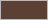
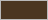
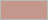
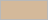
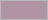
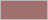

# Winter Cocoa — VS Code Theme

A warm, dark theme built from the **Manly Winter — Winter Cocoa** color palette.

## Palette

| Swatch | Hex | Role |
|--------|---------|------|
|  | `#1a1210` | Editor, sidebar and panel background (deep espresso) |
|  | `#3b2f2f` | Current line, word highlights, indent guides (espresso) |
|  | `#d9d6cf` | Foreground text, variables (cream) |
|  | `#5c4033` | Selection, button hover (walnut) |
|  | `#708090` | Comments, active borders, badges, muted UI (slate) |
|  | `#4b3621` | Source palette (umber) |

## Derived Syntax Colors

| Swatch | Color | Hex | Used for |
|--------|-------|---------|----------|
|  | Sage | `#a3b08a` | Strings, docstrings |
|  | Dusty rose | `#c4978c` | Keywords, control flow, `global` / `nonlocal`, exceptions, CSS at-rules |
|  | Pale blue | `#8aaec2` | Functions, HTML tags, links |
|  | Teal grey | `#84aeb8` | Builtins, builtin types (`int`, `str`, `list`), type hints, `__name__`, CSS properties |
|  | Warm sand | `#d4b99a` | Classes, headings, HTML attribute values |
|  | Caramel | `#c09878` | Decorators, f-string braces, escape sequences, HTML attributes |
|  | Mauve | `#b094a4` | Numbers, enum members, CSS colors and units |
|  | Bronze | `#a07850` | `True` / `False` / `None`, `ALL_CAPS` constants, read-only values |
|  | Plum grey | `#a08da0` | `self` / `cls`, CSS pseudo-classes |
|  | Bright slate | `#8a9eb2` | CSS / SCSS variables |

## Git Colors

| Swatch | Hex | Used for |
|--------|---------|----------|
|  | `#7a907a` | Added / untracked |
|  | `#8a9eb2` | Modified |
|  | `#a07070` | Deleted |
|  | `#9a8090` | Conflicts |

## Install

```bash
# From the extension directory:
code --install-extension winter-cocoa-0.1.0.vsix

# Or during development — open this folder in VS Code, press F5,
# then Cmd+K Cmd+T → select "Winter Cocoa".
# examples/orders.py exercises most of the Python colors.
```

## Build .vsix

```bash
npm install -g @vscode/vsce
cd winter-cocoa-theme
vsce package
```

## Source

Palette: [Manly Winter — Winter Cocoa](https://www.color-hex.com/color-palette/1075024)
